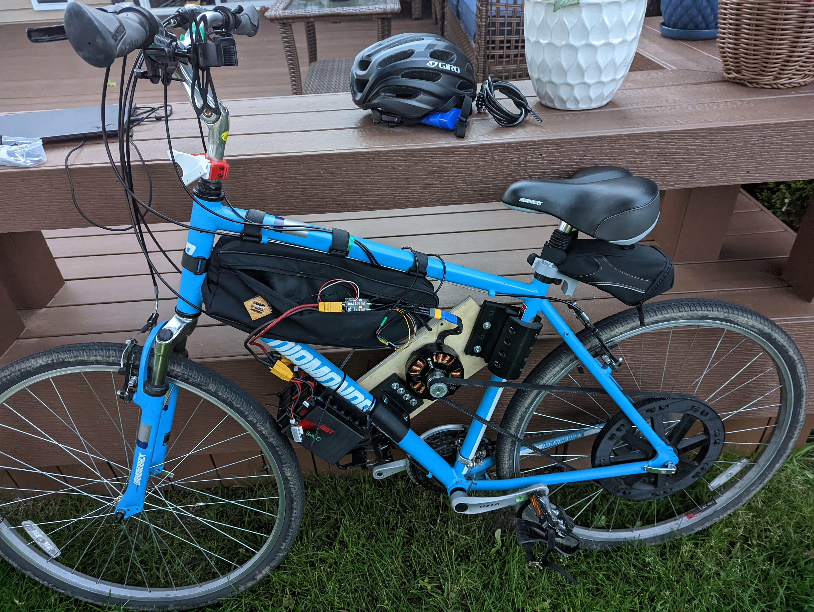

# DIY Mid-Drive E-Bike

A personal mid-drive e-bike prototype with custom mechanical parts and an ESP32 display for VESC telemetry. This repository preserves the CAD files, Arduino sketch, and photos from the build.

## What's here

- [Pictures](Pictures/) show the bike, rear pulley, dashboard, and CAD assembly.
- [Fusion 360 designs](CAD/Fusion360/) contain the assembly and individual part models.
- [STL files](CAD/STL/) contain printable exports for the mounts, clamps, and pulley.
- [VESCOM sketch](Code/VESCOM/VESCOM.ino) reads VESC data over UART and displays ride metrics on a TFT screen, with LED output through FastLED.

The files document this prototype. They are not a complete parts list or step-by-step build guide. Check fit, wiring, and current hardware requirements before adapting the designs to another bike.
